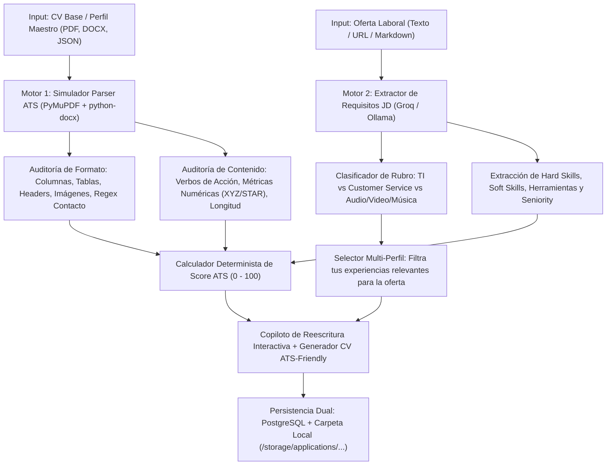

# 01 - Scope Inicial y Arquitectura: JobStep Local (Multi-Perfil & ATS Studio)

> **Estado:** Definición Inicial de Scope y Arquitectura  
> **Fecha:** Noviembre 2026  
> **Propósito:** Ingeniería inversa funcional de JobStep combinada con un gestor inteligente de múltiples perfiles profesionales (TI, Servicio al Cliente, Audio/Video/Música) y archivo automatizado en disco + base de datos por oferta laboral.

---

## 1. Visión General del Proyecto

**JobStep Local** es una plataforma local de evaluación, adaptación y gestión de CVs optimizados para filtros **ATS (Applicant Tracking Systems)**. A diferencia de JobStep comercial (que evalúa un único CV aislado en la nube bajo suscripción), **JobStep Local** está diseñado para perfiles **multidisciplinarios / polímatas** que postulan a rubros muy distintos:

1. **Área TI / Desarrollo (Objetivo Principal Full-Stack):** Desarrollo web, backend, frontend, bases de datos, automatización, soporte TI.
2. **Área Servicio al Cliente / Operaciones:** Atención al cliente, soporte técnico/comercial, resolución de incidencias, comunicación efectiva.
3. **Área Técnica-Artística & Multimedia (Freelance / Proyectos):** Composición y producción musical, diseño sonoro (*sound design*), postproducción de audio y edición de video.

El sistema actúa simultáneamente como:
- **Un "Master Knowledge Base" personal:** Donde cargas todos tus CVs previos, experiencias, proyectos, skills y logros sin importar el área.
- **Un Simulador ATS y Evaluador estilo JobStep:** Calcula el *Score ATS (0-100)* desglosado en Parseabilidad, Estructura, Impacto de Viñetas (Método XYZ/STAR) y Keyword Match contra una oferta real.
- **Un Selector y Ensamblador Inteligente de Perfil:** Al pegar una oferta laboral, el sistema detecta a qué rubro pertenece (o si es un rol híbrido) y selecciona las experiencias y habilidades más relevantes de tu base maestra para armar el CV ideal.
- **Un Organizador Híbrido (Base de Datos + Carpetas Locales):** Cada oferta laboral analizada se guarda en PostgreSQL para búsquedas rápidas en la UI **y simultáneamente** crea una carpeta física ordenada en tu disco con el `.md` de la oferta, el reporte de evaluación y los CVs generados (PDF/DOCX/MD).

---

## 2. Respuestas de Arquitectura: Decisiones Técnicas Clave

### 2.1 ¿FastAPI o Django para el Backend?
**Recomendación elegida: FastAPI** (con `SQLModel` / `SQLAlchemy 2.0` + `Pydantic v2`).

**¿Por qué FastAPI es superior a Django para este proyecto?**
1. **Orquestación de IA y Structured Outputs:** Tanto Groq como Ollama trabajan con esquemas JSON estrictos validados mediante **Pydantic**. FastAPI está construido nativamente sobre Pydantic, lo que permite compartir exactamente los mismos modelos de datos entre la respuesta del LLM, la validación de la API y la base de datos.
2. **Operaciones Asíncronas (`async/await`):** Evaluar un CV contra una oferta, llamar a Groq/Ollama, extraer coordenadas con `PyMuPDF` y compilar un PDF nuevo son tareas de I/O e inferencia donde el soporte asíncrono nativo de FastAPI (y *Server-Sent Events* para streaming de texto en tiempo real) es mucho más limpio y rápido que en Django.
3. **Micro-arquitectura limpia con Next.js:** Como el frontend será **Next.js (App Router)**, no necesitamos el motor de plantillas monolítico de Django ni su sistema de sesiones clásico. FastAPI expone una API RESTful + OpenAPI/Swagger automática en `http://localhost:8000/docs`.

---

### 2.2 ¿Es necesaria una Base de Datos? ¿PostgreSQL, MySQL o NoSQL?
**Recomendación elegida: Arquitectura Híbrida -> PostgreSQL (con JSONB) + Sistema de Archivos Local (`workspace/applications/`).**

**¿Por qué PostgreSQL es la mejor opción aquí (mejor que MySQL o MongoDB puro)?**
1. **Ya dominas PostgreSQL** y te sirve como proyecto de portafolio Full-Stack sólido.
2. **Lo mejor de SQL + NoSQL (`JSONB`):** Un CV y un reporte de evaluación ATS tienen partes altamente relacionales (Perfiles, Experiencias, Postulaciones, Estados de postulación: *Borrador, Enviado, Entrevista, Oferta*) y partes semi-estructuradas (el árbol JSON del análisis ATS, keywords faltantes, sugerencias por viñeta). El tipo de dato `JSONB` de PostgreSQL permite guardar estructuras complejas como un NoSQL pero manteniendo integridad relacional.
3. **Futuro soporte Vectorial (`pgvector`):** Cuando actives embeddings locales (vía Ollama `nomic-embed-text`) para comparar semánticamente tus proyectos con una oferta laboral, PostgreSQL soporta búsqueda vectorial nativa con la extensión `pgvector` sin instalar otra base de datos aparte.
4. **Sincronización con Sistema de Archivos Local:** Cumpliendo tu requerimiento de tener acceso directo e intuitivo a los archivos, cada vez que registres una oferta laboral en la app, el backend guardará el registro en PostgreSQL **y automáticamente creará una carpeta física** en tu computador con los archivos `.md` y `.pdf` listos para abrir desde el explorador de archivos o desde la interfaz web.

---

### 2.3 Motor de IA Dual: Groq API (Default) + Ollama (Local Switchable)
Se implementará el **Patrón Strategy / Provider Adapter** en el backend (`app/services/llm/`):

- **Por defecto (`LLM_PROVIDER=groq`):**
  - Usa el SDK oficial de Groq (`groq`) con modelos ultrarrápidos como `llama-3.3-70b-versatile` (para análisis profundo y reescritura de CVs) o `llama-3.1-8b-instant` (para tareas rápidas de clasificación).
  - Latencia casi instantánea (~300-500 tokens/seg), ideal para feedback interactivo viñeta por viñeta.
- **Modo 100% Local (`LLM_PROVIDER=ollama`):**
  - Conecta a `http://localhost:11434` usando modelos locales como `qwen2.5:7b` o `llama3.1:8b`.
- **Cambio en caliente desde la UI:**
  - En la pantalla de **Configuración (`Settings`)** de Next.js podrás cambiar un switch entre **Groq API** y **Ollama Local**, elegir el modelo, probar la conexión con un botón *"Test Connection"* y guardar tu API Key sin tocar código.

---

## 3. Cómo Funciona el Motor Interno de Evaluación ATS (Ingeniería Inversa de JobStep)

El motor local replica y mejora los 4 pilares internos de JobStep:



### 3.1 Fórmula del Score ATS Local (0 a 100 puntos)
Para que el puntaje no sea un número "inventado al azar" por la IA, el cálculo es **híbrido (heurístico determinista + evaluación estructurada)**:

$$\text{ATS Score} = 0.25(\text{Parseabilidad}) + 0.20(\text{Estructura}) + 0.25(\text{Impacto Viñetas}) + 0.30(\text{Match con Oferta})$$

1. **Parseabilidad y Formato ATS (25%):**
   - Detecta mediante coordenadas `(x0, y0, x1, y1)` de `PyMuPDF` si el PDF usa múltiples columnas o tablas que desordenan la lectura secuencial.
   - Verifica capa de texto real (no imagen escaneada).
   - Verifica presencia de Email, Teléfono, Ubicación y enlaces (LinkedIn, GitHub, Portafolio Musical/Video) fuera de encabezados/pies de página ocultos.
2. **Estructura y Completitud (20%):**
   - Presencia de secciones estándar reconocibles por parsers (Resumen/Perfil, Experiencia Laboral, Educación, Habilidades/Skills, Proyectos/Portafolio).
   - Densidad de palabras óptima (400 a 850 palabras; 1 a 2 páginas).
3. **Impacto de Viñetas / Bullet Points (25%):**
   - Diccionario bilingüe (Español / Inglés) de **Verbos de Acción fuertes** por rubro (TI, Atención al Cliente, Producción Audiovisual).
   - Detección de cuantificación/métricas (`%`, `$`, tiempos de respuesta, cantidad de clientes atendidos, proyectos entregados, reducción de latencia/tiempos).
   - Detección de frases débiles o pasivas (*"Encargado de...", "Ayudé a..."*).
4. **Match con la Oferta Laboral (30%):**
   - Cruce exacto y por sinónimos de *Hard Skills*, herramientas, tecnologías y *Soft Skills* extraídas del anuncio laboral.

---

## 4. Sistema Multi-Perfil Personalizado ("Mi Bóveda Profesional")

Para resolver tu necesidad de postular a **Full-Stack TI**, **Servicio al Cliente** y **Audio/Música/Video (Freelance o Empleo)** sin mezclar información que distraiga al reclutador, el sistema tendrá una arquitectura de **"Perfil Maestro + Vistas/Perfiles Especializados"**:

### 4.1 Ingesta de CVs Existentes + Ingesta en Texto Libre (Generador Desde Cero con Formato Harvard)
El sistema soporta dos formas complementarias de alimentar tu información:
1. **Subida de CVs existentes (PDF / DOCX / MD):** Extrae y estructura automáticamente experiencias previas.
2. **Ingesta en Texto Libre / "Brain Dump" (Sin Formato):** Puedes escribir o pegar texto suelto en lenguaje natural contando tu experiencia, estudios, herramientas o proyectos sin preocuparte por el formato (ej. *"Trabajé entre 2021 y 2023 atendiendo clientes, resolviendo reclamos técnicos, también hice música y diseño sonoro para 3 cortometrajes usando Reaper y Ableton, y desarrollé una app web con Next.js y PostgreSQL..."*).
   - **Transformación Automática a Estándar Harvard & Modern ATS:** El motor IA toma ese texto desestructurado, extrae fechas, cargos, tecnologías y logros, redacta las viñetas aplicando la fórmula **Harvard / Google XYZ** (Verbo de acción en pasado/presente + logro + métrica/impacto) y ensambla un CV desde cero con el **Formato Harvard Moderno** (una sola columna, orden cronológico inverso limpio, jerarquía tipográfica clara, sin gráficos distractores y 100% parseable por ATS).
- Todo lo ingresado (sea por archivo o por texto libre) se consolida en tu **Bóveda Profesional (`Master Profile`)** clasificando cada ítem con etiquetas (`tags` de categoría):
  - `ti-fullstack`, `ti-support`, `customer-service`, `music-production`, `sound-design`, `video-editing`, `transversal`.

### 4.2 Perfiles Base Preconfigurados (Templates de Rol)
1. **Perfil TI / Full-Stack Developer:** Prioriza stack tecnológico, proyectos de software, GitHub, arquitectura y habilidades transferibles (resolución de problemas, comunicación con clientes).
2. **Perfil Customer Service / Soporte Técnico-Comercial:** Prioriza trato con usuarios, resolución de conflictos, métricas de atención, empatía, herramientas CRM/ticketing y soporte técnico.
3. **Perfil Creativo / Audio, Música & Video:** Prioriza producción musical, composición, diseño sonoro, edición de video, DAWs/NLEs (Reaper, Ableton, Logic, Premiere, DaVinci, etc.), links a reels/portafolio y gestión de clientes freelance.
4. **Perfil Híbrido Dinámico (Auto-Ensamblado por IA):** Cuando pegas una oferta (por ejemplo, *"Soporte Técnico para empresa de Software Audio"* o *"Desarrollador Frontend con conocimientos multimedia"*), la IA selecciona las piezas exactas de tus 3 mundos para crear el CV perfecto para esa vacante.

---

## 5. Organización Física de Ofertas Laborales en Disco + Base de Datos

Cada vez que creas o analizas una oferta laboral en la aplicación, el sistema registra los metadatos en PostgreSQL y **sincroniza una carpeta dedicada en tu disco local**:

```text
jobstep-local/
└── storage/
    ├── master_profile/
    │   ├── master_knowledge_base.json      # Toda tu información consolidada
    │   └── uploaded_cvs/                   # Tus CVs originales subidos como referencia
    │       ├── cv_ti_fullstack_original.pdf
    │       ├── cv_customer_service.pdf
    │       └── cv_produccion_musical_video.pdf
    │
    └── applications/                       # Una carpeta por cada oferta laboral
        ├── 2026-11-25_AcmeCorp_FullStack-Developer/
        │   ├── 01_oferta_laboral.md        # Descripción limpia, empresa, link, sueldo, requisitos extraídos
        │   ├── 02_evaluacion_ats.md        # Reporte completo del Score ATS, keywords faltantes y feedback
        │   ├── 03_cv_adaptado.md           # Fuente editable en Markdown del CV optimizado para esta oferta
        │   ├── 04_cv_adaptado_ATS.pdf      # CV final en PDF 100% compatible con ATS listo para enviar
        │   ├── 05_carta_presentacion.md    # Cover letter / mensaje de postulación adaptado
        │   └── metadata.json               # Score, fecha, estado, perfil usado, modelo IA usado
        │
        ├── 2026-11-25_SoundStudio_Sound-Designer-Video-Editor/
        │   ├── 01_oferta_laboral.md
        │   ├── 02_evaluacion_ats.md
        │   ├── 03_cv_adaptado.md
        │   └── 04_cv_adaptado_ATS.pdf
        │
        └── 2026-11-26_TechSupport_Customer-Success-Agent/
            └── ...
```

### Ventajas de este enfoque:
- **Todo al alcance sin depender de que la app esté abierta:** Puedes abrir la carpeta `storage/applications/` en VS Code, Obsidian o el Explorador de Windows y ver exactamente qué CV enviaste a cada empresa y cuál era la descripción de la oferta (ya que muchas empresas borran el aviso semanas después y uno olvida qué pedían cuando te llaman a entrevista).
- **Acceso rápido desde la Web UI (Next.js):** En el dashboard verás todas las carpetas como tarjetas interactivas con filtros por rubro (*TI*, *Customer Service*, *Audio/Video*), puntaje ATS, estado de postulación y botón para **"Abrir carpeta local"** o **"Descargar PDF"**.

---

## 6. Seguridad y Versiones Parchadas del Stack (Auditoría CVE 2025–2026)

Dado que **JobStep Local** procesa archivos PDF y DOCX (que históricamente son vectores de exploits de memoria y XML) y utiliza React Server Components / Next.js + FastAPI, el proyecto exige las siguientes versiones mínimas y medidas de endurecimiento (*hardening*):

1. **Frontend (Next.js `^16.4.6` + React `^19.3.1` + Tailwind CSS `^4.3.5` con `pnpm 11.28+`):**
   - Parcheado contra **React2Shell (`CVE-2025-55182` / `CVE-2025-66478`)**, contra el RCE de `use cache` (`GHSA-673q-mjm6-r5xr`), el RCE en Windows (`CVE-2026-75604`), el RCE de procesamiento de imágenes (`CVE-2026-96889`, forzando `sharp >=0.35.5`) y los avisos de caché de noviembre 2026 (`16.4.5+`).
2. **Backend (FastAPI `>=0.165.0`, Starlette `>=1.10.0`, Pydantic `>=2.14.4`, `python-multipart >=0.0.33`):**
   - Parcheado contra el RCE crítico en FastAPI (`CVE-2026-2978`), el ataque de timing en API Keys (`CVE-2026-23996`), la vulnerabilidad *BadHost* y SSRF por rutas UNC en Windows de Starlette (`CVE-2026-48710`, `CVE-2026-54282`), el bypass de validación en campos extra de Pydantic (`CVE-2026-133429` — además usaremos `model_config = ConfigDict(extra="forbid")` en los esquemas de entrada) y el DoS por cabeceras multipart (`CVE-2026-42561`).
3. **Procesamiento Seguro de Documentos (`PyMuPDF >=2.0.0`, `python-docx >=1.2.0`, `defusedxml >=0.7.1`):**
   - Parcheado contra el desbordamiento de búfer en `PyMuPDF <2.0` (`CVE-2026-120752`) y Path Traversal (`CVE-2026-3029`).
   - Validación estricta de archivos subidos: verificación de *Magic Bytes* (`%PDF-` o firma ZIP de `.docx`), límite de tamaño de 10 MB, sanitización de nombres de archivo y carpetas (`slugify` sin caracteres `..`, `/`, `\`) para evitar cualquier *Path Traversal* al escribir en `storage/applications/`.

---

## 7. Hub de Mejores Prácticas de CV (Formato Harvard & Tendencias ATS Actualizables con Groq + Web Search)

La aplicación contará con una sección dedicada en la interfaz web llamada **"Guía & Mejores Prácticas ATS / Harvard"** que cumplirá dos funciones:

1. **Referencia Interactiva Permanente:**
   - Explicación visual y ejemplos prácticos del **Formato Harvard** (por qué funciona, estructura de secciones, tipografías recomendadas, márgenes y densidad).
   - Guía del **Método XYZ de Google** y **Método STAR** con ejemplos adaptados a tus 3 áreas: **TI / Full-Stack**, **Servicio al Cliente** y **Producción Musical / Sonido / Video**.
   - Checklist interactivo de qué hacer (*Do's*) y qué evitar (*Don'ts*) frente a sistemas ATS modernos (Workday, Greenhouse, Lever, Taleo).
2. **Actualización Periódica Inteligente (Búsqueda Web + Síntesis con Groq):**
   - Dado que las tendencias de reclutamiento y filtros ATS evolucionan constantemente, esta sección incluirá un botón **"Actualizar Tendencias y Prácticas (Groq Search)"** (además de actualización periódica configurable).
   - **Cómo funciona técnicamente:** El backend utiliza el modelo compuesto de búsqueda web de Groq (`groq/compound` / `compound-beta` con Web Search nativo o búsqueda web vía DuckDuckGo/Tavily procesada por `llama-3.3-70b-versatile`) para consultar las últimas recomendaciones de reclutamiento técnico, cambios en parsers ATS y estándares modernos de CV.
   - El resultado se guarda tanto en PostgreSQL como en un archivo Markdown versionado (`storage/knowledge_base/best_practices_ats_harvard.md`) mostrando la fecha de última actualización, fuentes consultadas y nuevas reglas que se integran directamente a tus prompts de creación de CV.
